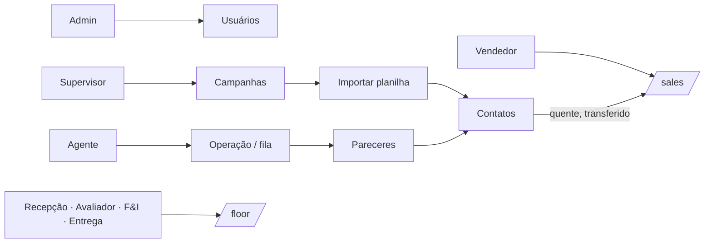
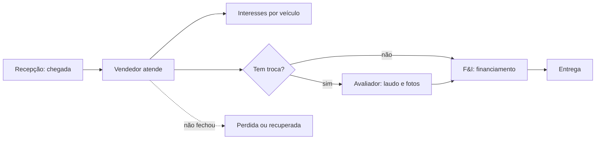

# Estrutura da BDC — Campanhas de Ligação

CRM interno para **campanhas de ligação** de clientes, com uma frente de **feirão** (recepção, avaliação de usados, F&I e entrega) e uma tela de **vendas** para contatos quentes.

**Stack:** Next.js 16 (App Router) · React 19 · Prisma 7 sobre PostgreSQL · NextAuth 5 (credenciais) · Tailwind · Radix/shadcn · Zod.

---

## 1. Visão geral



---

## 2. Papéis e acesso

| Papel | Tela inicial | Pode |
|---|---|---|
| `ADMIN` | `/campaigns` | Tudo, incluindo usuários |
| `SUPERVISOR` | `/campaigns` | Criar/ativar campanhas, ranking, redistribuir, exportar |
| `AGENT` | `/campaigns` | Operar a fila da campanha em que está vinculado |
| `SELLER` | `/sales` | Oportunidades e agenda |
| `RECEPTIONIST` | `/floor` | Chegada de clientes e placas |
| `APPRAISER` | `/floor` | Avaliação de usados (laudo, fotos, custos) |
| `FINANCE` | `/floor` | F&I |
| `DELIVERY` | `/floor` | Entrega do veículo |

**Como o acesso é aplicado (duas camadas):**

- `src/proxy.ts`: bloqueia qualquer rota não pública e redireciona para `/login`. Rotas públicas: `/login`, `/forgot-password`, `/reset-password`, `/api/auth`, `/api/password/*`, assets.
- `src/lib/permissions.ts`: cada handler de API chama `requireUser()` e depois `requireRole()` / `requireSupervisorOrAdmin()` / `requireAdmin()` / `requireSeller()`. Nunca se confia em id ou papel vindo do cliente.

---

## 3. Módulo de campanhas (núcleo)

### 3.1 Ciclo da campanha

`CampaignStatus`: `DRAFT → ACTIVE ⇄ PAUSED → COMPLETED` (ou `CANCELED`).

A fila de operação só libera ligações com a campanha `ACTIVE`. Enquanto estiver em rascunho, a tela mostra o estado de inativa (`inactive-campaign-state.tsx`).

### 3.2 Fluxo de uma campanha

1. **Admin** cadastra a equipe em `/users`.
2. **Supervisor** cria a campanha (`create-campaign-dialog.tsx`), em rascunho.
3. Vincula agentes (`manage-agents.tsx`) e ajusta pareceres (`manage-dispositions.tsx`).
4. Importa a base em `campaigns/[id]/import` (wizard: análise → prévia → commit).
5. Ativa a campanha.
6. **Agentes** ligam pela fila e registram o parecer (`disposition-form.tsx`).
7. Contatos quentes vão para o vendedor (`transfer`, `notify-sellers`).
8. **Supervisor** acompanha dashboard, ranking e histórico.

### 3.3 Contatos e tentativas

- `CampaignContact` · status em `ContactStatus`: `UNTREATED`, `ATTEMPTING`, `FOLLOW_UP`, `TREATED`, `CONVERTED`, `NOT_REACHED`.
- Temperatura do contato em `ContactTemperature`. Pareceres em `CampaignDisposition`, com categoria em `DispositionCategory`.
- Cada ligação gera uma linha em `CampaignContactAttempt`.
- Toda troca de dono fica em `CampaignContactAssignmentHistory`, com motivo em `AssignmentChangeReason`.
- `CampaignImport` e `CampaignImportSession` guardam o histórico de importações e a sessão de análise.
- `CampaignTransfer` registra a passagem de contato para vendas.
- `CampaignDistributionState` controla a distribuição da fila entre agentes.

### 3.4 Telas por campanha (`src/app/(app)/campaigns/[id]/`)

| Tela | Função |
|---|---|
| `operation` | Fila e discador: WhatsApp via VoIP Wavoip, ligação pelo celular, conversa no Auttus/Chatwoot |
| `contacts` | Lista com filtros, ficha do contato, mover e reabrir |
| `dashboard` | Funil, performance por agente, distribuição de pareceres |
| `ranking` | Ranking de agentes |
| `history` | Histórico de ações |
| `settings` | Configurações da campanha, token Wavoip, pareceres |
| `import` | Importação de planilha |

### 3.5 Serviços do módulo (`src/server/services/`)

`campaign.ts` · `campaign-access.ts` · `campaign-operation.ts` · `campaign-contact-actions.ts` · `campaign-contact-ficha.ts` · `campaign-contacts-list.ts` · `campaign-dispositions.ts` · `campaign-distribution.ts` · `campaign-import.ts` · `import-session-cache.ts` · `campaign-incoming.ts` · `campaign-transfer.ts` · `campaign-history.ts` · `campaign-metrics.ts` · `campaign-export.ts` · `sellers-notify.ts`

---

## 4. Módulo de feirão (`/floor`)

Permite operar um evento presencial de venda de veículos.

### 4.1 Modelos

| Modelo | Papel |
|---|---|
| `FairEvent` | Evento (status em `FairEventStatus`) |
| `FairVehicle` | Veículo em estoque do evento |
| `FairVisit` | Visita de um cliente (estágio em `FairVisitStage`, canal em `FairEntryChannel`, forma de chegada em `FairArrivalMode`, origem da informação em `FairAwarenessSource`) |
| `FairVisitInterest` | Interesse do cliente por veículo |
| `FairAppraisal` | Avaliação do usado (status em `FairAppraisalStatus`, pneus em `TireCondition`) |
| `FairAppraisalPhoto` | Fotos da avaliação (slot em `FairPhotoSlot`) |
| `FairAppraisalCost` | Custos de reparo da avaliação (tipo em `FairAppraisalCostKind`) |
| `FairDelivery` | Entrega (status em `FairDeliveryStatus`) |
| `FairTask` | Tarefa do evento (status em `FairTaskStatus`, prioridade em `FairTaskPriority`) |
| `FairExpense` | Despesa do evento |

### 4.2 Fluxo da visita



Ações de visita (rotas em `api/floor/visits/[visitId]/`): `handoff`, `transfer`, `interests`, `appraisal`, `close`, `lose`, `recover`.

### 4.3 Telas

Em `src/components/floor/`:

- **Recepção:** `reception-desk.tsx`, busca por placa ou cliente (`plate-lookup.ts` consulta FIPE pela API Brasil).
- **Avaliação:** `appraisal-desk.tsx`, `appraisal-detail.tsx`, com fotos e custos.
- **F&I:** `finance-desk.tsx`.
- **Entrega:** `delivery-desk.tsx`.
- **Vendedor no feirão:** `seller-desk.tsx`.
- **Controle do evento:** `floor-control.tsx`, `floor-dashboard.tsx`, `floor-stock.tsx`, `floor-customer-base.tsx`, `close-fair-button.tsx`.

Serviços: `src/server/services/floor.ts` e `fair-control.ts`.

---

## 5. Módulo de vendas (`/sales`)

- **Oportunidades** (`Opportunity`, status em `OpportunityStatus`): criadas na transferência de um contato quente da campanha para um vendedor (`services/campaign-transfer.ts`), vinculadas ao cliente e à campanha de origem (`originCampaignId`). O vendedor atualiza status e notas (`updateSellerOpportunity`). Interesse em `EventInterest`, prazo de compra em `PurchaseTimeline`.
- **Feirão:** o código do feirão não cria oportunidade. Ele trabalha com as próprias visitas (`FairVisit`) e o vendedor atende no `seller-desk.tsx`.
- **Agendamentos** (`Appointment`, status em `AppointmentStatus`).
- **Clientes** (`Customer`).

Serviço: `src/server/services/sales.ts`. Componentes: `sales-agenda.tsx`, `sales-status-select.tsx`, `sales-notes-field.tsx`.

---

## 6. Administração e transversais

- **Usuários** (`/users`): criação, papel, ativação, token Wavoip por agente. `services/users.ts`.
- **Clientes** (`/customers`): cadastro administrativo. `services/customers.ts`.
- **Auditoria:** `AuditLog`, registrada por `services/audit.ts`.
- **Senha:** esqueci e redefinir (`services/password.ts`). Em dev, `AUTH_DEV_RESET_LINKS=true` mostra o link.
- **PWA:** `public/sw.js`, `app/manifest.ts`, `components/pwa/`.
- **Imagens:** compressão no cliente (`lib/compress-photo.ts`) e no servidor (`services/image-compress.ts`).
- **Exportação CSV:** `lib/csv.ts`, `lib/spreadsheet.ts`, link em `components/export-csv-link.tsx`.

---

## 7. Integrações externas

| Integração | Arquivo | Uso |
|---|---|---|
| Wavoip | `lib/wavoip.ts`, `lib/wavoip-client.ts` | VoIP e WhatsApp na operação. Token por campanha ou por agente |
| Chatwoot / Auttus | `lib/auttus-chat.ts`, `services/auttus-conversation.ts` | Abre conversa do contato no Auttus. Variáveis `CHATWOOT_*` e `AUTTUS_APP_URL` |
| API Brasil | `services/plate-lookup.ts` | Consulta FIPE pela placa. Variável `APIBRASIL_TOKEN` |

---

## 8. Modelos de dados (resumo)

**25 modelos e 22 enums** em `prisma/schema.prisma` (771 linhas).

- **Acesso:** `User`
- **Campanhas:** `Campaign`, `CampaignAgent`, `CampaignDisposition`, `CampaignContact`, `CampaignContactAttempt`, `CampaignContactAssignmentHistory`, `CampaignImport`, `CampaignImportSession`, `CampaignTransfer`, `CampaignDistributionState`
- **Vendas:** `Customer`, `Opportunity`, `Appointment`
- **Feirão:** `FairEvent`, `FairVehicle`, `FairVisit`, `FairVisitInterest`, `FairAppraisal`, `FairAppraisalPhoto`, `FairAppraisalCost`, `FairDelivery`, `FairTask`, `FairExpense`
- **Auditoria:** `AuditLog`

**19 migrations** em `prisma/migrations/`. Do `init` (18/08) até `damage_photo_caption` (23/11).

---

## 9. Mapa de pastas

```
src/
  app/
    (app)/            telas autenticadas (campaigns, sales, floor, customers, users)
    api/              handlers REST, por domínio
    login/, forgot-password/, reset-password/
  server/services/    regras de negócio no servidor
  schemas/            validação Zod por domínio
  components/         telas e componentes por domínio (campaigns, floor, sales, users, customers, layout, ui, pwa, auth)
  lib/                utilitários e clientes externos (permissions, auth, prisma, wavoip, auttus-chat, csv, phone, ranking)
  generated/prisma/   cliente Prisma gerado. Não editar à mão
  types/              tipos de domínio e augmentations do NextAuth
  proxy.ts            middleware de autenticação
prisma/
  schema.prisma
  migrations/
  seed.ts             usuários demo (demo1234) e pareceres padrão
tests/                Playwright (auth-and-lifecycle.spec.ts)
deploy/               Caddyfile
public/               ícones, sw.js, uploads
```

---

## 10. Pontos de atenção

- **Estado do git:** as migrations de feirão de 22/11 a 23/11 (`fair_floor_roles` até `damage_photo_caption`), `src/app/api/floor/` e as alterações em `schema.prisma` e `seed.ts` **ainda não estão commitadas**. Commitar antes de qualquer deploy.
- **Seed destrutivo para campanhas demo:** `npx prisma db seed` remove campanhas de demonstração (ver README). Não rodar em base com dados reais.
- **Next 16:** o `AGENTS.md` manda ler `node_modules/next/dist/docs/` antes de escrever código, porque a API mudou em relação a versões anteriores.
- **Dados pessoais:** a BDC guarda telefone e dados de cliente. Não logar esses campos.
